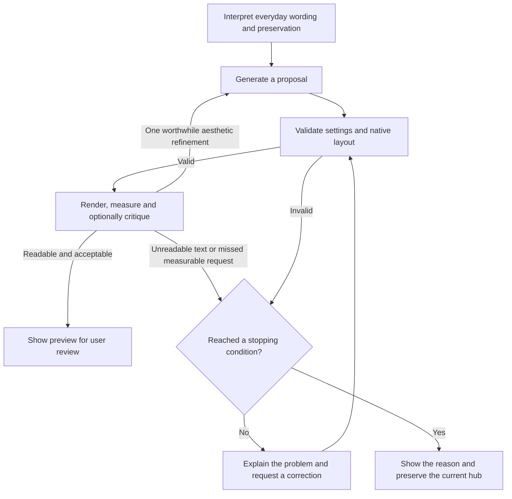

# Bounded automatic validation and repair

Creation and editing validate each generated proposal before it becomes available
to apply. Failed proposals go back to the same local model with focused feedback.
The editor is unchanged until the user applies a valid proposal.

The limits are shared across the whole generation run:

| Condition | Behaviour |
| --- | --- |
| Valid proposal | Render and optionally review its design, then show the preview. |
| Attempt limit | One initial proposal plus at most three corrections: four proposal attempts. Optional critiques add inference calls within the same deadline. |
| Native icon layout | Simple portrait/item dimensions reflow the native grid together. An icon-sized width on the six-slot strip is resolved as individual icon sizing; explicit custom grids remain supported and measured. |
| Explicit visual edits | Grounded component targets and common requested treatments resolve to independent native styles. Verify requested palettes, row fills, type hierarchy, portrait framing, header size and preserved geometry in the rendered hub. No preset selection is required. |
| Known measured failures | One local pass applies permitted causal fixes together, then recompiles and measures again. Accept only measured improvement; still require every readability and request check before Apply. This avoids spending inference on predictable frame/contrast corrections. |
| Rendered repair | Readability failures request a small style-only patch (up to 600 output tokens), retaining the composition and original edit permissions. Every patched result is compiled and measured again. |
| Aesthetic refinement | At most one, with the best valid readable candidate retained. Skip it if the remaining budget cannot cover the observed generation time plus 25% headroom, rendered checks, critique and any model switches. |
| Interpretation | One pass, with at most one correction for malformed interpretation JSON, using the same loaded model. |
| Time limit | Ten minutes **total**, including interpretation, measurement, generation, rendering, validation, optional reviewer loading/model switches, critique and corrections. Each phase receives only the remaining time. |
| Preview preparation | At most 12 seconds per preview. Required preparation failures stop with resource/phase diagnostics; they never certify an unmeasured proposal or trigger another model correction. |
| Asset readiness | Only fonts used by preview text are awaited (at most 2 seconds). Offscreen images load eagerly with a 5-second limit; DOM measurement does not await image decoding. Background tabs have a 100 ms animation-frame fallback. |
| Optional feedback | At most 45 seconds for measured review or 90 seconds shared across image review and its focused retry. Model switches are limited to 60 seconds each. A previously validated readable proposal survives optional capture/review failure. |
| Repeated proposal | Stop if a rejected answer recurs, ignoring JSON formatting and key order. Identical rendered failures also stop, even when redundant model operations change. |
| No progress | Stop after three consecutive answers produce the same validation issues. Newly generated layer UUIDs do not count as progress. |
| Runtime/GPU error | Stop and release the worker, rather than repeatedly retrying a failed device. |
| Cancel | Terminate the worker and ignore late responses. |

The first condition reached ends the run. Initial generator loading is separate;
loading the optional Phi reviewer counts toward the shared deadline. A hung inference is terminated when the
shared deadline expires; a response arriving after that deadline is discarded.

Preview preparation and optional review have shorter phase limits within the shared
deadline. Evaluation exports record `phases`, `phaseLimits` and `failedPhase`, plus
font/image readiness when available. The ten-minute limit is a final ceiling, not
the amount of time the editor waits for an image or font. Structural validation
alone does not allow Apply: required rendered readability and intent checks still run.



## Feedback and preservation

Quoted changes, preservation notes and unsupported-request descriptions have no
per-string character caps. Rejecting an otherwise valid interpretation because a
quote exceeds 150 characters wastes a correction and can discard meaningful
qualifiers. Recovered request clauses are also retained in full. The existing
output-token budget, list bounds, typed targets/checks, evidence grounding and
shared deadline still apply. Only the display summary is shortened. This change
is separate from the editor's existing 1,500-character input limit.

The interface explains the current validation problem, for example:
“Some panels overlap. Correcting automatically (1/3).” Streaming progress keeps the
correction count visible. A successful repair shows how many corrections were
needed; an unsuccessful run explains why it stopped and summarizes the remaining
problem. Pixel measurements remain in diagnostics instead of becoming requirements
for the user to fix manually.

Every compilation uses the original hub snapshot. A rendered readability correction
retains the candidate plan and adds only permitted style operations; it never adopts
the rejected hub as the current editor state. The original instruction and edit
property/target restrictions remain in effect, including for compact CSS strings.
Structural/schema errors retain the full-proposal correction path. Creation keeps
its existing contrast-repair locks, so a correction cannot replace unrelated design
choices to evade validation.

Style corrections receive the relevant current styles, layout measurements and
specific failures, without regenerating the full composition. Full-proposal repairs
receive only the latest failed candidate and validation summary with the original
context. Old attempts do not accumulate in the conversation. Evaluation exports
include the pipeline version, attempt kind, patch output, final candidate, measured
failures, phase times and limits. `localCorrections` counts accepted native repair
passes; each attempt records its original measurements, proposed local operations,
remaining issues and whether the correction was accepted. Original model output is
retained separately when a local correction changes the final plan.
Count individual rendered failures when accepting partial local improvement;
aggregate message counts alone can hide a corrected foreground or background.
`refinementBudget` records the estimated cost and remaining time when deciding
whether an optional design refinement is worth starting. This estimate controls
optional work only; it never relaxes validation of a proposed hub.

Validation covers the existing schema, native component dimensions, canvas bounds,
content collisions and edit-preservation rules; creation also checks text contrast.
Rendered fulfillment checks cover supported semantic requests: dimensions, icon
hierarchy, fine row separators, team gradients, text size and joined bottom tables.
Readable minimums are reported as limitations. Requests without an automatic check
are labelled for preview review rather than silently certified.
Structural warnings, such as deliberate placement in the gameplay area, are
displayed without retries. The separate optional rendered-design review can request
one aesthetic refinement. See [design knowledge and review](ai-hub-design-knowledge.md)
for measured versus image input, memory and fallback behaviour. These checks do not
certify aesthetic quality.

## Verification

The 2026-10-19 timeout export isolated a preview-preparation stall: interpretation
took 36.4 seconds and generation 111 seconds, but the run ended at 600.6 seconds
before any rendered measurements were recorded. Phi was disabled and no repairs
ran. The export cannot identify which unbounded browser/resource wait stalled.
The earlier preview fix addressed that wait. A later export exposed a separate
native icon/grid conflict and full-regeneration repair loop; see
[the roster timeout analysis](ai-hub-roster-timeout-analysis.md). The current shared
ceiling is ten minutes, alongside shorter resource/phase limits.

The preview regression deliberately leaves unrelated `document.fonts.ready` and
connected-image `decode()` promises unresolved. It replays recorded model output
without live inference and checks that the actual browser preview still completes
mandatory measurements, renders at 720p/1080p and applies/saves successfully.
Run with `AI_QA_CREATIVE=1`, `AI_QA_SINGLE=1`,
`AI_QA_REPLAY=tests/fixtures/ai-creative-recorded.json` and
`AI_QA_STALLED_PREVIEW=1` using `npm run test:ai-browser` after building.
Results are written to `tmp-visual-qa/ai-hub-builder/stalled-preview-regression/`.
These replay times measure preview preparation, not Qwen generation speed.

`npm test` covers successful repairs through the fourth attempt, repeated answers,
lack of progress, a shared ten-minute deadline, an unresponsive worker, cancellation,
GPU failure, contrast constraints, original-hub preservation and bounded context.
The deadline tests advance a simulated clock instead of waiting ten minutes. They
also verify that a correction finishing after five minutes can still succeed within
the ten-minute total budget.

From `src/web`:

```powershell
npm test
npm run build
$env:AI_QA_REPAIR = '1'
npm run test:ai-browser
Remove-Item Env:AI_QA_REPAIR
```

This browser mode runs real Qwen3 inference. The test harness injects one unreadable
foreground into the first generated response at the validation boundary, then lets
the actual local model correct it. The production app contains no fault-injection
hook. The test checks visible feedback, recorded validation history, a valid final
proposal, rendering at 1080p/720p, Apply/Save and cancellation. Reports are saved
under `tmp-visual-qa/ai-hub-builder/repair-regression/`.

Recorded verification on 2026-10-16: all 72 automated tests and the production
build passed. The browser fault-injection scenario detected the contrast failure,
displayed the correction reason/count, and the real local model produced a valid
proposal on the next attempt. Generation plus repair took 48.2 seconds. Rendering
checks passed at both resolutions; Apply/Save and cancellation also passed. The
report records the configured 300,000 ms shared limit and both validation results.
