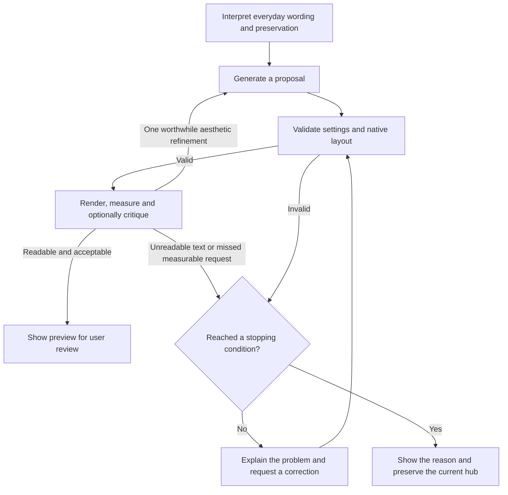

# Bounded automatic validation and repair

Creation and editing validate each generated proposal before it becomes available
to apply. Failed proposals go back to the same local model with focused feedback.
The editor is unchanged until the user applies a valid proposal.

The limits are shared across the whole generation run:

| Condition | Behaviour |
| --- | --- |
| Valid proposal | Render and optionally review its design, then show the preview. |
| Attempt limit | One initial proposal plus at most three corrections: four proposal attempts. Optional critiques add inference calls within the same deadline. |
| Aesthetic refinement | At most one, with the best valid readable candidate retained. |
| Interpretation | One pass, with at most one correction for malformed interpretation JSON, using the same loaded model. |
| Time limit | Five minutes **total**, including interpretation, baseline measurement, generation, rendering, validation, critique and corrections. Each inference receives only the remaining time. |
| Repeated proposal | Stop if a rejected answer recurs, ignoring JSON formatting and key order. |
| No progress | Stop after three consecutive answers produce the same validation issues. Newly generated layer UUIDs do not count as progress. |
| Runtime/GPU error | Stop and release the worker, rather than repeatedly retrying a failed device. |
| Cancel | Terminate the worker and ignore late responses. |

The first condition reached ends the run. Model download/initialization is a
separate step before generation starts. A hung inference is terminated when the
shared deadline expires; a response arriving after that deadline is discarded.



## Feedback and preservation

The interface explains the current validation problem, for example:
“Some panels overlap. Correcting automatically (1/3).” Streaming progress keeps the
correction count visible. A successful repair shows how many corrections were
needed; an unsuccessful run explains why it stopped and summarizes the remaining
problem. Pixel measurements remain in diagnostics instead of becoming requirements
for the user to fix manually.

Every attempt uses the original instruction and original hub snapshot. An edit
does not treat the last rejected layout as its new base. Creation retains its
instruction-specific schema and existing contrast-repair locks, so the model
cannot bypass valid constraints by changing an unrelated background or font.

Only the latest failed candidate and a short validation summary accompany the
original context on the next inference. Old attempts are not accumulated in the
model's conversation. The evaluation download still contains every attempted
output, validation result, stop reason, elapsed time and configured limits.

Validation covers the existing schema, native component dimensions, canvas bounds,
content collisions and edit-preservation rules; creation also checks text contrast.
Rendered fulfillment checks cover supported semantic requests: dimensions, icon
hierarchy, fine row separators, team gradients, text size and joined bottom tables.
Readable minimums are reported as limitations. Requests without an automatic check
are labelled for preview review rather than silently certified.
Structural warnings, such as deliberate placement in the gameplay area, are
displayed without retries. The separate optional rendered-design review can request
one aesthetic refinement. See [design knowledge and review](ai-hub-design-knowledge.md)
for measured versus image input, memory and fallback behaviour. These checks do not
certify aesthetic quality.

## Verification

`npm test` covers successful repairs through the fourth attempt, repeated answers,
lack of progress, a shared five-minute deadline, an unresponsive worker, cancellation,
GPU failure, contrast constraints, original-hub preservation and bounded context.
The deadline test advances a simulated clock instead of waiting five minutes.

From `src/web`:

```powershell
npm test
npm run build
$env:AI_QA_REPAIR = '1'
npm run test:ai-browser
Remove-Item Env:AI_QA_REPAIR
```

This browser mode runs real Qwen3 inference. The test harness injects one unreadable
foreground into the first generated response at the validation boundary, then lets
the actual local model correct it. The production app contains no fault-injection
hook. The test checks visible feedback, recorded validation history, a valid final
proposal, rendering at 1080p/720p, Apply/Save and cancellation. Reports are saved
under `tmp-visual-qa/ai-hub-builder/repair-regression/`.

Recorded verification on 2026-10-16: all 72 automated tests and the production
build passed. The browser fault-injection scenario detected the contrast failure,
displayed the correction reason/count, and the real local model produced a valid
proposal on the next attempt. Generation plus repair took 48.2 seconds. Rendering
checks passed at both resolutions; Apply/Save and cancellation also passed. The
report records the configured 300,000 ms shared limit and both validation results.
